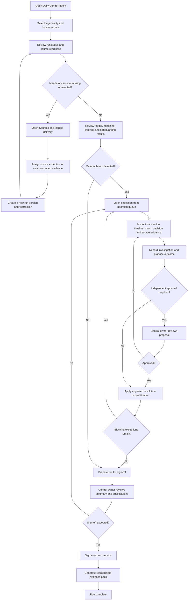

# Control Analyst Daily Review

## Status

Proposed user workflow. Not implemented.

## User outcome

The control analyst should be able to determine whether the previous business date is ready for sign-off, investigate every material break and leave a complete evidence trail without accessing internal databases.

## Primary flow

## Important alternate states

- A source that is late but still inside its agreed window remains pending rather than failed.
- Incomplete mandatory evidence visibly qualifies downstream results and blocks unqualified sign-off.
- An analyst cannot approve their own restricted resolution.
- Late or corrected evidence after sign-off creates a new run version; it never rewrites the signed result.
- A user without access to the selected legal entity sees a restriction state rather than partial financial data.

## Screen mapping

| Workflow step | Primary screen |
| --- | --- |
| Select and assess run | Daily Control Room |
| Inspect delivery problem | Sources |
| Understand transaction journey | Transaction Explorer |
| Review deterministic relationship | Matching Workbench |
| Investigate and resolve break | Exception Detail |
| Review coverage | Safeguarding Position |
| Approve and attest | Run Sign-off |
| Reproduce conclusion | Evidence and Audit Explorer |
