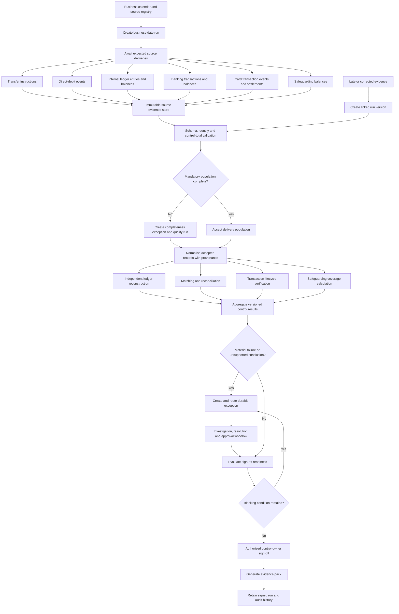

# Control Processing Flow

## Status

Proposed deterministic control process. Not implemented.

## Process objective

For one legal entity and business date, Proofly should transform immutable source evidence into reproducible control results, exceptions and an evidence-backed sign-off decision.

## Processing diagram

## Process guarantees

- Original evidence remains immutable or content-addressed.
- Every normalised record retains source-delivery and source-record lineage.
- Controls use explicit versions of schemas, mappings, lifecycle models and tolerances.
- Reprocessing identical inputs and rules is deterministic and idempotent.
- Incomplete evidence is never represented as a successful zero result.
- Exceptions, approvals and sign-off append history rather than replacing it.
- Card events, processor settlements and bank movements remain separate populations linked through controlled many-to-one matches.
